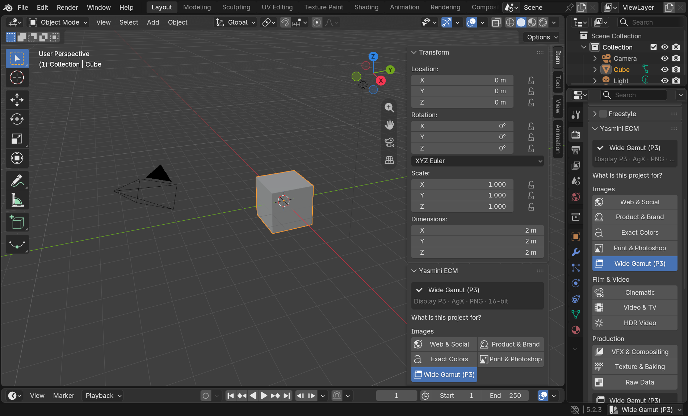
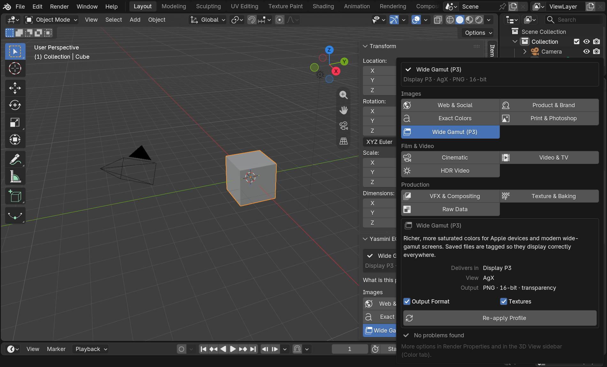
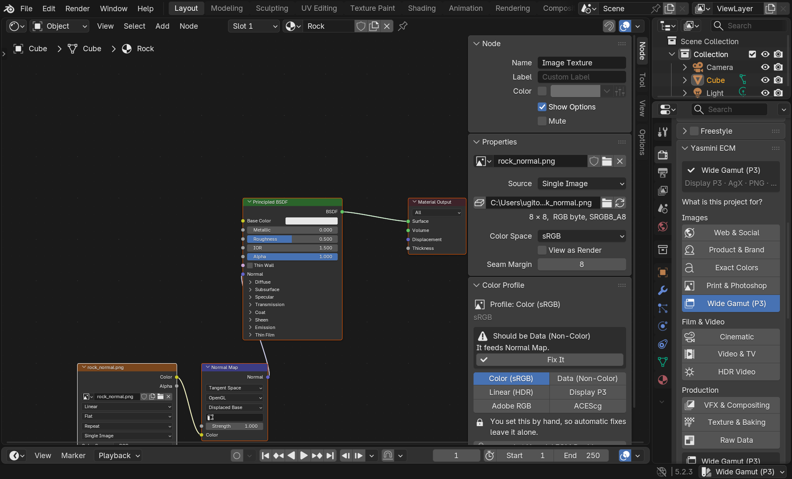

# Yasmini ECM for Blender

**Easy Color Management**, Photoshop-style. Pick what your project is for and Yasmini ECM
sets up everything else: display, view transform, look, working space, output
format, and the color space of every texture.



## Install

1. Download `yasmini_ecm-1.0.0.zip` from the [latest release](../../releases/latest).
   Don't unzip it.
2. In Blender, open **Edit › Preferences › Get Extensions**.
3. In the drop-down at the top right, choose **Install from Disk…** and pick the zip.

Requires Blender 4.2 or newer. Tested on 4.4, 4.5, 5.1 and 5.2.

## Use it

1. Open **Render Properties › Yasmini ECM**, the **Color** tab in the 3D View sidebar
   (press N), or click the profile name at the bottom right of the window.
2. Click what the project is for. The box below explains what that profile sets up.
3. Press **Apply Profile**.

That's it. The status bar shows the profile, like Photoshop's document profile, and the
Health Check tells you, in plain language, if something drifts or looks wrong.



## The profiles

| Profile | Delivers in | View | Output | Best for |
|---|---|---|---|---|
| Web & Social | sRGB | AgX | PNG 8-bit | websites, social media, client previews |
| Product & Brand | sRGB | Khronos PBR Neutral | PNG 8-bit | product shots, e-commerce, packaging |
| Exact Colors | sRGB | Standard | PNG 8-bit | logos, UI, motion graphics, toon shading |
| Print & Photoshop | sRGB | AgX | TIFF 16-bit | print, retouching in Photoshop |
| Wide Gamut (P3) | Display P3 | AgX | PNG 16-bit | iPhone, iPad and Mac, modern phones |
| Cinematic | sRGB | AgX, Medium High Contrast | PNG 16-bit frames | animation, short films |
| Video & TV | Rec.709 (BT.1886) | AgX | H.264 MP4 | TV, Resolve, Premiere |
| HDR Video | Rec.2100 PQ | AgX HDR 1000 nits | PNG 16-bit frames | HDR TVs, YouTube HDR (Blender 5+) |
| VFX & Compositing | sRGB | ACES 2.0 (Blender 5+) or AgX | Multilayer EXR | Nuke, Fusion, Resolve |
| Texture & Baking | sRGB | Standard | PNG 8-bit | texture painting, baking, game assets |
| Raw Data | sRGB | Raw | EXR 32-bit | depth and normal passes, masks, datasets |

On Blender 5 and newer, **VFX & Compositing** also switches the file's working space to
ACEScg. Blender converts existing colors, so nothing changes visually.

Applying a profile keeps your exposure and gamma tweaks. Only Exact Colors, Texture &
Baking and Raw Data reset them, because those profiles promise a 1:1 result.

If a setting isn't available (an older Blender, or a studio OCIO config), the closest
option is used and Yasmini ECM tells you which.

## Textures

The most common color mistake in Blender is a normal or roughness map left on sRGB. Yasmini
ECM follows each image's **Color** output through reroutes, node groups and converter nodes (Separate Color, Math, Color Ramp…) to see what it actually feeds:

- **Base Color, Emission, world background** → Color (sRGB); EXR and HDR files → Linear
- **Normal Map, Bump, Displacement, Roughness, Metallic, Alpha…** → Data (Non-Color)
- **Masks** (through a Color Ramp or a Mix factor) → suggested, but never changed without asking
- **Unconnected images** → judged by name (`wood_Normal_4k.png`, `rock_rough.jpg`, `ORM`…)

Applying a profile fixes the clear cases. **Textures › Review One by One** lists everything
else with the reason. With **Fix New Textures Automatically** on (the default), new images
get the right color space as soon as you connect them. Yasmini ECM never touches:

- images you set by hand
- images that were already in a file when you opened it (the Health Check flags those instead)
- images painted or baked in Blender, whose pixels a new color space would alter



Select an Image Texture node (Node tab of the Shader Editor sidebar), or open an image in the
Image Editor (Tool tab), to see its profile and assign one Photoshop-style:
Color (sRGB), Data (Non-Color), Linear (HDR), Display P3, Adobe RGB (Blender 5.2+) or ACEScg.

## Color profiles in saved files

Blender 5 embeds an ICC profile in the PNG, JPEG and TIFF files it saves. Blender 4 doesn't,
so a Display P3 render opens in Photoshop or a browser as if it were sRGB and looks dull. On
Blender 4, Yasmini ECM tags every saved render (stills and animation frames) with the right
profile. **Advanced › Embed Profile in Files…** does the same for files already on disk, like
**Edit › Assign Profile** in Photoshop. Only the tag changes; the pixels stay the same.

## Preferences

In **Edit › Preferences › Add-ons › Yasmini ECM**:

- **Profile for New Projects**: applied to every new, unsaved file.
- **My Monitor**: leave it on *Same as the Profile* unless your screen shows wide-gamut colors
  natively (a wide-gamut monitor in its native mode on Windows or Linux). The viewport then
  uses your monitor while saved files keep the profile's display, through Blender's output
  color override. On macOS leave it as is: the system already adapts colors to your screen.
- **Fix New Textures Automatically**, **Embed Color Profiles in Renders** (Blender 4),
  **Show Profile in Status Bar**.

## Limits

- Blender can't render straight to Adobe RGB or CMYK. For print, the Print & Photoshop
  profile gives you a 16-bit sRGB TIFF to convert in Photoshop.
- EXR files always store linear light. The view transform (AgX, ACES…) is not baked into them.
- The HDR profile needs Blender 5 and an HDR display to preview correctly.

## Development

```
yasmini_ecm/               the extension (manifest, Python modules)
tests/test_addon.py        headless tests: profiles, textures, live mode, health, ICC tagging
tests/ui_smoke.py          opens Blender, draws every panel and saves screenshots
dist/                      built extension zip
```

Run the tests and rebuild the zip:

```bash
blender -b --factory-startup --python tests/test_addon.py
```

```bash
blender --command extension build --source-dir yasmini_ecm --output-dir dist
```

## License

GPL-3.0-or-later, like Blender itself. See [LICENSE](LICENSE).
